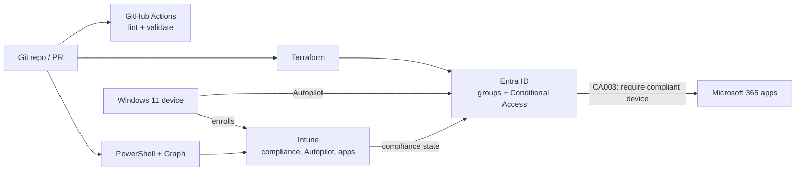

# Entra ID + Intune Secure Endpoint Baseline


A reproducible, code-driven security baseline for a small organization on **Microsoft Entra ID** and **Microsoft Intune**. Identity policy, device enrollment, compliance, and app deployment are defined as code, validated in CI, and documented with the reasoning behind each decision.

> Built and tested in a lab tenant. Replace the placeholders in [Results](#results) with your own findings.

## The problem
Small organizations often configure identity and endpoints by clicking through admin portals. That's slow to repeat, hard to review, and easy to misconfigure. This project treats the configuration as code so it can be reviewed in pull requests, rebuilt on demand, and explained.

## What's included
| Area | What it does | Where |
|---|---|---|
| Entra ID | Dynamic groups, break-glass group, Conditional Access (MFA, block legacy auth, require compliant device) | `iac/terraform/` |
| Intune compliance | Windows baseline: BitLocker, Secure Boot, code integrity, Defender, password, minimum OS | `iac/intune/policies/windows-compliance.json` |
| Autopilot | User-driven Entra join, standard user, `CORP-<serial>` naming | `iac/intune/policies/autopilot-profile.json` |
| App deployment | 7-Zip as a required Win32 app, defined by `app.json` | `iac/intune/apps/` |
| Automation | Non-compliant device report, user offboarding | `scripts/` |
| CI | PowerShell lint, Terraform format/validate | `.github/workflows/ci.yml` |

## Architecture


## Repo layout
```
.
├── docs/                  # lab setup, design decisions, Autopilot + Win32 walkthroughs
├── iac/
│   ├── terraform/         # Entra ID resources
│   └── intune/            # policy JSON, app definitions, deploy scripts
├── scripts/
│   ├── reporting/         # Get-NonCompliantDevices.ps1
│   └── lifecycle/         # Invoke-Offboarding.ps1
└── .github/workflows/     # CI
```

## Prerequisites
- A lab tenant with Entra ID P1/P2 and Intune licenses (see [docs/lab-setup.md](docs/lab-setup.md))
- Terraform 1.5+, PowerShell 7+, and the `Microsoft.Graph` module
- A Windows 11 VM for Autopilot and compliance testing
- Windows plus the `IntuneWin32App` module for Win32 app packaging

## Quick start
```powershell
# 1. Entra ID (groups + Conditional Access, report-only)
cd iac/terraform
terraform init
terraform plan

# 2. Intune compliance policy (preview first)
./iac/intune/Deploy-CompliancePolicy.ps1 -GroupId <group-object-id> -WhatIf

# 3. Autopilot profile
./iac/intune/Deploy-AutopilotProfile.ps1 -GroupId <autopilot-devices-group-id> -WhatIf

# 4. Reporting
./scripts/reporting/Get-NonCompliantDevices.ps1
```
Walkthroughs: [Autopilot](docs/autopilot.md) · [Win32 apps](docs/win32-apps.md) · [Design decisions](docs/design-decisions.md)

## Security notes
- Conditional Access policies ship in **report-only** mode. Review the sign-in logs before enforcing.
- A break-glass group is excluded from every policy to prevent lockout.
- No secrets, tenant IDs, installers, or exported tenant data are committed (see `.gitignore`). Use OIDC federation or certificates for CI authentication.
- Scripts support `-WhatIf` and request least-privilege Graph scopes.

## Results
> Fill this in after running the project in your lab. Real numbers and screenshots matter more than polish.

| Metric | Before | After |
|---|---|---|
| Devices enrolled via Autopilot | _ | _ |
| Compliant devices | _ | _ |
| Conditional Access sign-ins that would have been blocked (report-only) | _ | _ |
| Time to enroll a new device | _ | _ |

**Screenshots**
- [ ] Conditional Access report-only results
- [ ] Autopilot device list and OOBE
- [ ] Device compliance state in Intune
- [ ] 7-Zip install status
- [ ] Green CI run

## What I learned
> Add 3 to 5 honest takeaways: what broke, what surprised you, what you'd change.

## Roadmap
- [ ] macOS and mobile compliance policies
- [ ] App protection policies (MAM)
- [ ] Sign-in log and compliance dashboards
- [ ] Remote Terraform state with OIDC-authenticated CI plans
- [ ] Windows Update rings and a security baseline profile

## License
MIT (add a `LICENSE` file before publishing).
