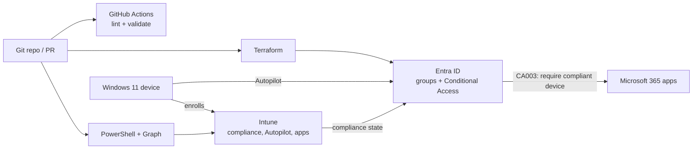
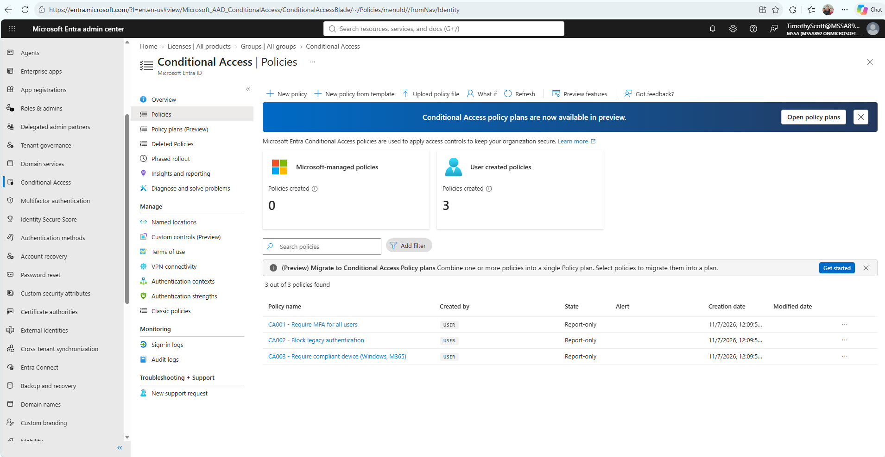
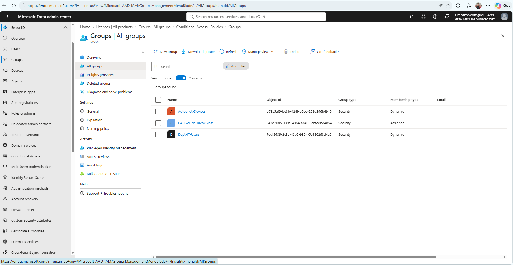
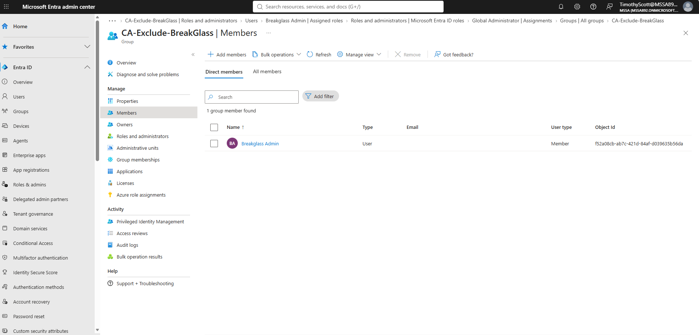
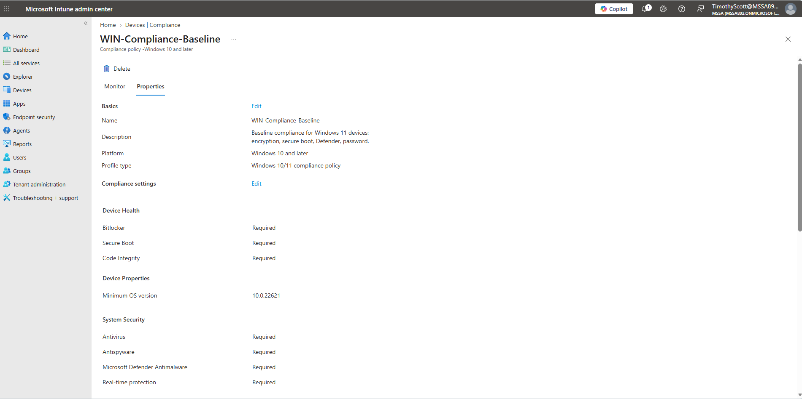
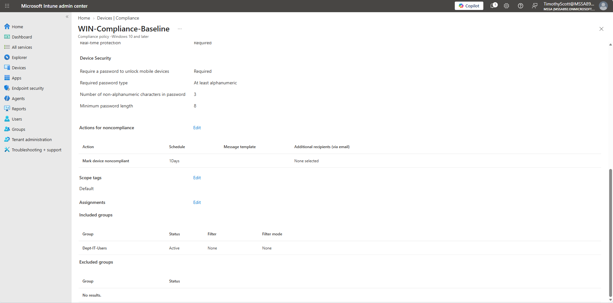
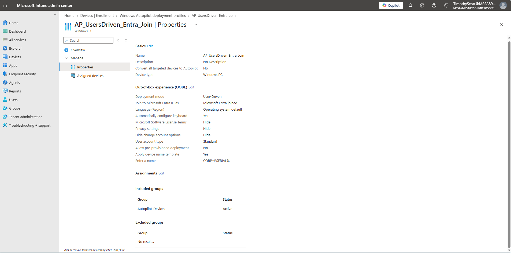

# Entra ID + Intune Secure Endpoint Baseline


A code-driven security baseline for a small organization on **Microsoft Entra ID** and **Microsoft Intune**. Identity policy and device compliance are defined as code, validated in CI, and documented with the reasoning behind each decision.

Built and tested in a lab tenant. This README separates what I verified from what I have not yet tested.

## The problem
Small organizations often configure identity and endpoints by clicking through admin portals. That is slow to repeat, hard to review, and easy to misconfigure. This project treats the configuration as code so it can be reviewed in pull requests, rebuilt on demand, and explained.

## Status

| Area | Status | Notes |
|---|---|---|
| Entra groups + Conditional Access (Terraform) | Verified | Applied to the lab tenant: 3 groups, 3 policies in report-only mode |
| Windows compliance policy (JSON + Graph script) | Verified | Deployed and assigned from code; Real-time protection was finished in the portal |
| Autopilot deployment profile | Verified (portal) | Built in the portal; the Graph beta create call returned a generic 400 (see Known limitations) |
| Break-glass account | Verified | Global Administrator, kept out of the policies by the exclusion group |
| CI (PowerShell lint, Terraform validate) | Verified | Green check on `main` |
| Non-compliant device report script | Not yet tested | Needs enrolled devices |
| Offboarding script | Not yet tested | Supports `-WhatIf` |
| Win32 app deployment script | Not yet tested | Needs Windows, the IntuneWin32App module, and a packaged app |

## What's included

| Area | What it does | Where |
|---|---|---|
| Entra ID | Break-glass group, dynamic groups, Conditional Access: MFA (CA001), block legacy auth (CA002), require compliant device (CA003) | `iac/terraform/` |
| Intune compliance | Windows baseline: BitLocker, Secure Boot, code integrity, Defender, password, minimum OS | `iac/intune/policies/windows-compliance.json` |
| Autopilot | User-driven Entra join, standard user, `CORP-<serial>` naming | `iac/intune/policies/autopilot-profile.json` |
| App deployment | 7-Zip as a required Win32 app, defined by `app.json` | `iac/intune/apps/` |
| Automation | Non-compliant device report, user offboarding | `scripts/` |
| CI | PowerShell lint, Terraform format and validate | `.github/workflows/ci.yml` |

## Architecture


## Evidence

**Conditional Access policies (report-only)**



**Entra groups created by Terraform**



**Break-glass account excluded from Conditional Access**



**Windows compliance policy**




**Autopilot deployment profile**



## Repo layout
```
.
├── docs/                  # lab setup, design decisions, walkthroughs, screenshots
├── iac/
│   ├── terraform/         # Entra ID resources
│   └── intune/            # policy JSON, app definitions, deploy scripts
├── scripts/
│   ├── reporting/         # Get-NonCompliantDevices.ps1
│   └── lifecycle/         # Invoke-Offboarding.ps1
└── .github/workflows/     # CI
```

## Prerequisites
- A lab tenant with Entra ID P1/P2 and Intune licenses (see [docs/lab-setup.md](docs/lab-setup.md))
- Terraform 1.5+, PowerShell 7+, Azure CLI, and the `Microsoft.Graph.Authentication` module
- An admin account with MFA registered (security defaults blocks Graph sign-in without it)
- A Windows 11 VM for Autopilot and compliance testing

## Quick start
```powershell
# 1. Entra ID (groups + Conditional Access, report-only)
az login --tenant <tenant-id> --allow-no-subscriptions
cd iac/terraform
terraform init
terraform plan

# 2. Intune compliance policy (preview first)
cd ../intune
./Deploy-CompliancePolicy.ps1 -GroupId <group-object-id> -WhatIf
```
Walkthroughs: [Autopilot](docs/autopilot.md) · [Win32 apps](docs/win32-apps.md) · [Design decisions](docs/design-decisions.md)

## Security notes
- Conditional Access policies are in **report-only** mode. I review sign-in logs before enforcing anything.
- A break-glass account is excluded from every policy to prevent lockout. Its credentials are stored offline and never in this repo.
- No secrets, installers, or Terraform state are committed (see `.gitignore`).
- Scripts support `-WhatIf` and request least-privilege Graph scopes.

## Known limitations
- **Autopilot profile:** the Graph beta create call returned a generic 400 in this tenant, so I built the profile in the portal. The JSON and script are kept as the intended configuration.
- **Compliance policy:** Real-time protection did not apply from the Graph call and was set in the portal. The Graph readback also does not display the Defender fields, so the portal was the source of truth.
- **Untested scripts:** the reporting, offboarding, and Win32 packaging scripts have not been run against enrolled devices yet.
- **Security defaults** had to be satisfied (MFA registered) before Microsoft Graph PowerShell could sign in.

## What I learned
- **Licenses and settings are per tenant.** I had several lab tenants, and Terraform failed with a 403 until I confirmed which tenant my CLI was signed in to. I now run `az account show` before every apply.
- **Security defaults can block admin tooling.** Graph sign-in failed with error 530035. The sign-in log named the cause, and registering MFA fixed it.
- **Verify in more than one place.** A script reported success, but the portal showed one Defender setting missing, and the Graph readback hid fields the portal did show.
- **Terraform state does not belong in Git.** I committed it by accident, reset the commit, added a `.gitignore`, and force-pushed with `--force-with-lease`.
- **Beta APIs can fail without a useful message.** When the Autopilot create call returned a generic 400, I built it in the portal and documented the gap.

## Roadmap
- [ ] Enroll a test VM through Autopilot and record compliance results
- [ ] Switch CA001 and CA002 from report-only to enforced after reviewing sign-in logs
- [ ] macOS and mobile compliance policies
- [ ] Remote Terraform state with OIDC-authenticated CI plans
- [ ] Windows Update rings and a security baseline profile

## License
MIT
