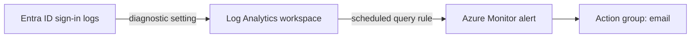

# Break-glass sign-in monitoring

**Status: designed, not deployed.** The lab tenant has no Azure subscription, and routing Entra sign-in logs to Log Analytics needs one. Until that exists, the manual review script below is the working control.

## Why monitor it

The break-glass account is a Global Administrator kept out of every Conditional Access policy so a bad policy can never lock everyone out. That makes it the most powerful account in the tenant with the fewest guardrails. Its credentials are stored offline, so in normal operation it never signs in. That makes monitoring simple: any sign-in at all is worth investigating.

## What works today: manual review

`scripts/reporting/Get-BreakGlassSignIns.ps1` reads the Entra sign-in logs through Microsoft Graph and lists every sign-in by the account.

```powershell
./scripts/reporting/Get-BreakGlassSignIns.ps1 -UserPrincipalName <break-glass-upn> -Days 30
```

- Read-only. By default it signs in with Microsoft Graph PowerShell and requests the `AuditLog.Read.All` and `Directory.Read.All` scopes.
- If the tenant blocks the Microsoft Graph PowerShell app, sign in with the Azure CLI and add `-UseAzCli`. In my lab tenant, security defaults blocked Graph PowerShell for a regular admin account (error 530035) while the Azure CLI worked:

  ```powershell
  az login --tenant <tenant> --allow-no-subscriptions --use-device-code
  ./scripts/reporting/Get-BreakGlassSignIns.ps1 -UserPrincipalName <break-glass-upn> -UseAzCli
  ```

- The expected result is "No sign-ins found".
- Add `-OutputPath` for a CSV and `-WhatIf` to preview the file write.
- Add `-FailIfFound` to make a scheduled job fail when a sign-in exists.
- Limits: it covers interactive sign-ins, and logs are kept for 30 days with P1/P2.

Status: written, **not yet tested** against the lab tenant.

## Near-real-time alert (planned)



1. **Export the logs.** In Entra ID, add a diagnostic setting that sends `SignInLogs` to a Log Analytics workspace in an Azure subscription.
2. **Query.** Match on the account's **object ID**, not the user name, because a user name can be changed:

   ```kusto
   SigninLogs
   | where UserId == "<break-glass-object-id>"
   | project TimeGenerated, UserPrincipalName, ResultType, IPAddress,
             Location, AppDisplayName, ConditionalAccessStatus
   ```

3. **Alert rule.** A scheduled query rule that runs every 5 minutes over the last 5 minutes, fires when the result count is greater than 0, severity 1.
4. **Notify.** An action group that emails the administrators. Use an address that does not depend on the break-glass account.

Sign-in logs reach the workspace after a short delay, so expect the alert minutes after the sign-in, not seconds.

## Test plan once deployed

1. Sign in as the break-glass account on purpose, from a known location.
2. Confirm the alert fires and the email arrives.
3. Confirm the sign-in shows in the review script.
4. Record the date and result here.

Test the account on a regular schedule even without the alert, so a broken break-glass account is found before an outage, not during one.

## Open questions

- Which email or channel should receive the alert, and who is on call to act on it?
- Should the break-glass account use a passkey or FIDO2 key instead of a password alone? It is excluded from MFA policies, so the credential itself must be strong.
- Add an alert for changes to the exclusion group, since a quiet addition there is the other way to weaken the control.
